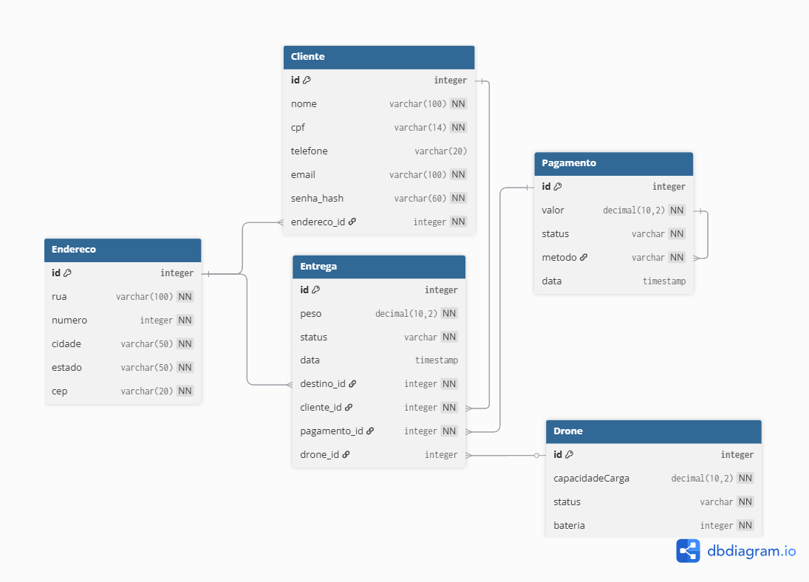

<h2><a href= "https://www.mackenzie.br">Universidade Presbiteriana Mackenzie</a></h2>
<h3><a href= "https://www.mackenzie.br/graduacao/sao-paulo-higienopolis/sistemas-de-informacao">Ciência da Computação</a></h3>


<font size="+12"><center>
MoranaAir</center></font>

*Conteúdo*

- [Autores](#Autores)
- [Descrição do Projeto](#Descrição-do-Projeto)
- [Diagrama de Classes](#Diagrama-de-Classes)
- [Diagrama de Senquencia](#Diagrama-de-Sequência)
- [Integração de Modelos](#Integração-de-Modelos)
- [Diagrama de Projeto](#Diagrama-de-Projeto)
- [Integração Sequência + Colaboração](#Integração-Sequência-+-Colaboração)
- [Diagrama de Estados](#Diagrama-de-Estados)
- [Referências](#Referências)


# Autores

* Ana Julia Yaguti Matilha
* Guilherme Clauz Morlina da Silva

# Descrição do Projeto

Sistema acadêmico de entregas com drones, desenvolvido em Java com UML e boas práticas de segurança. Permite cadastro de clientes e drones, solicitação de entregas, atribuição automática do drone adequado e histórico de entregas, com validação de dados e prevenção de falhas.

# Diagrama de Classes

Diagrama de relacionamento entre classes para os seus atributos e operações


# Diagrama de Sequência

Diagrama de ordem e interação dos objetos


# Integração de Modelos


### Esquema SQL

#### `clientes`
```sql
CREATE TABLE IF NOT EXISTS clientes (
    id BIGINT AUTO_INCREMENT PRIMARY KEY,
    nome VARCHAR(255),
    cpf VARCHAR(20),
    telefone VARCHAR(50),
    email VARCHAR(255) UNIQUE,
    senha VARCHAR(255)
) ENGINE=InnoDB;
```

**Responsabilidade:** Armazenar dados de clientes
- **PK:** `id` (auto-increment)
- **UK:** `email` (único, evita duplicatas)
- **Validação:** CPF 11 dígitos, email contém @

---

#### `enderecos`
```sql
CREATE TABLE IF NOT EXISTS enderecos (
    id BIGINT AUTO_INCREMENT PRIMARY KEY,
    cliente_id BIGINT,
    rua VARCHAR(255),
    numero INT,
    cidade VARCHAR(255),
    estado VARCHAR(255),
    cep VARCHAR(50),
    FOREIGN KEY (cliente_id) REFERENCES clientes(id) ON DELETE CASCADE
) ENGINE=InnoDB;
```

**Responsabilidade:** Armazenar endereços associados aos clientes
- **PK:** `id`
- **FK:** `cliente_id` → `clientes.id` (cascata)
- **Validação:** CEP formato XXXXX-XXX

---

#### `drones`
```sql
CREATE TABLE IF NOT EXISTS drones (
    id BIGINT AUTO_INCREMENT PRIMARY KEY,
    capacidade DOUBLE,
    status VARCHAR(50),
    bateria INT
) ENGINE=InnoDB;
```

**Responsabilidade:** Armazenar dados de drones disponíveis
- **PK:** `id`
- **Status:** DISPONIVEL, MANUTENCAO
- **Bateria:** 0-100%
- **Pré-carregado:** 4 drones ao inicializar (semearDronesPadrao)

---

#### `entregas`
```sql
CREATE TABLE IF NOT EXISTS entregas (
    id BIGINT AUTO_INCREMENT PRIMARY KEY,
    peso DOUBLE,
    cliente_id BIGINT,
    destino_rua VARCHAR(255),
    destino_numero INT,
    destino_cidade VARCHAR(255),
    destino_estado VARCHAR(255),
    destino_cep VARCHAR(50),
    status VARCHAR(50),
    pagamento_status VARCHAR(50),
    FOREIGN KEY (cliente_id) REFERENCES clientes(id) ON DELETE SET NULL
) ENGINE=InnoDB;
```

**Responsabilidade:** Armazenar entregas realizadas
- **PK:** `id`
- **FK:** `cliente_id` (SET NULL se cliente deletado)
- **Status:** PENDENTE, EM_ANDAMENTO, ENTREGUE
- **Pagamento Status:** PENDENTE, APROVADO, RECUSADO

---

#### `pagamentos`
```sql
CREATE TABLE IF NOT EXISTS pagamentos (
    id BIGINT AUTO_INCREMENT PRIMARY KEY,
    valor DOUBLE,
    metodo VARCHAR(50),
    status VARCHAR(50),
    data TIMESTAMP,
    entrega_id BIGINT
) ENGINE=InnoDB;
```

**Responsabilidade:** Armazenar histórico de pagamentos
- **PK:** `id`
- **Métodos:** PIX, CREDITO, DEBITO, BOLETO
- **Status:** PENDENTE, APROVADO, RECUSADO
- **Data:** Timestamp da transação

---

# Diagrama de Projeto


# Integração Sequência + Colaboração


# Diagrama de Estados


